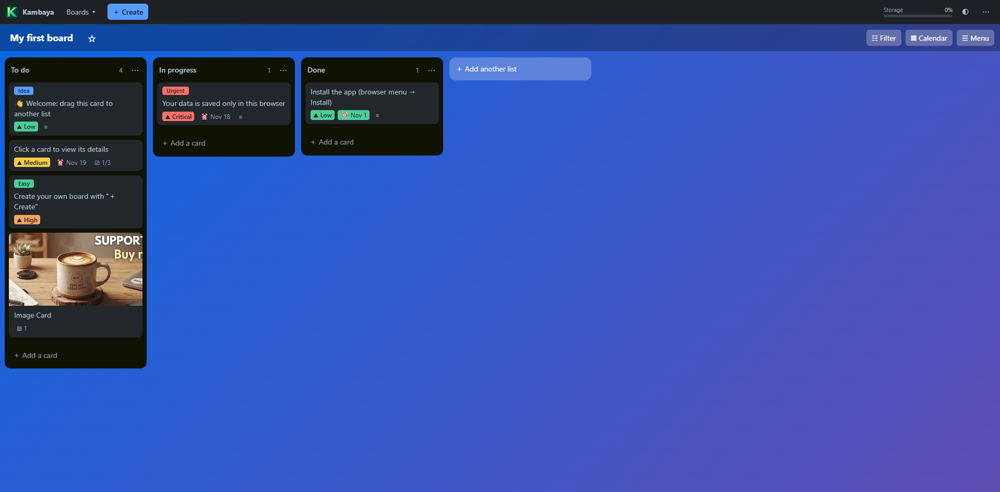

# Kanbaya PWA

Static Kanban application with local IndexedDB storage using Dexie 4.2.1. No backend, CDN, npm, or build step is required to run it.

This README covers running and using Kanbaya. See [TECHNICAL.md](TECHNICAL.md) for architecture, storage and backup internals, deployment rules, and development tests.



## License

Except for third-party components, this project's code and documentation are licensed under [Creative Commons Attribution-NonCommercial-NoDerivatives 4.0 International](https://creativecommons.org/licenses/by-nc-nd/4.0/) (`CC-BY-NC-ND-4.0`). See [LICENSE](LICENSE) for the full legal terms.

The license permits noncommercial copying and sharing of the unadapted material with appropriate attribution, a link to the license, and preservation of supplied notices. You may produce adaptations for noncommercial purposes, but may not share adapted material under this license. Commercial use or sharing adaptations requires separate permission from the relevant rights holders, unless an applicable copyright exception permits it. The material is provided without warranty.

This is not an open-source software license. This declaration does not revoke permissions already granted under licenses for earlier versions.

Third-party components retain their own licenses; the project license does not replace them. Preserve the license files and applicable notices in [vendor/](app/vendor/) when redistributing or deploying the application. DOMPurify is used under its Apache-2.0 option.

## Running and deploying

The product website lives at the repository root, with screenshots in `assets/`. Its gallery includes filters, calendar, card details, statistics, timeline, and board tools; each screenshot opens at full size. The application and its development files live in `app/`.

The home screen displays the product version in the bottom-left footer and the **Buy Me a Coffee** button on the right. Boards do not show the footer.

Serve the repository directory over HTTPS, or localhost for development. For example, with Node installed:

```powershell
node app\tests\server.js
```

or 

```powershell
python -m http.server 8766
```

Kill process
```powershell
netstat -ano | findstr :8766
taskkill /PID <1234> /F
```

The Node server prints a clickable link to the application: `http://127.0.0.1:8765/app/`. Open `http://127.0.0.1:8765/` for the product website. With the Python example, use port `8766` instead. These servers are for development only. For production, see [Deployment and runtime resources](TECHNICAL.md#deployment-and-runtime-resources). Opening the HTML using `file:` does not provide the expected PWA functionality.

The website's **Install Kanbaya** button opens the application with an installation banner. Its **Install** button opens the native prompt when the browser provides one; otherwise it explains how to use the browser's install option. Availability depends on browser, device, and install status.

The export/import menu uses icons to distinguish file transfers, Google Drive backups, and deleting data.

For Google Drive backups, see the [step-by-step Google Cloud setup guide (Spanish)](app/docs/GOOGLE_DRIVE_SETUP.md), including the OAuth configuration and usage instructions.

The public [Privacy Policy](info/privacy.html) and [Terms of Service](info/terms.html) are linked from the product website footer and work without JavaScript. Publish them before adding their full URLs in Google Auth Platform's Branding settings. Review these texts for your deployment, operator/contact details and applicable legal obligations; they describe the current implementation, not a guarantee of legal compliance or Google verification.

## Using boards

Opening a board adds a tab to the top bar between **Create** and the storage meter, while the **Boards** menu remains available. Tabs persist in this browser across restarts, including on the home screen. Closing a tab never deletes its board; closing the active tab opens the adjacent tab to its right, or to its left if there is none, and returns home when no tabs remain. The strip has no scrollbar; **Show open boards** lists all open tabs when space is limited, with a close button on each entry to close tabs without opening them. Navigation still asks before discarding an edited description. Open-tab preferences are stored separately from board backups.

The home board search retains keyboard focus and the caret while filtering. Board names are sized using their rendered font metrics, wrap on narrow screens, and remain editable without clipping; long names on home tiles also wrap.

Use **Add card** in a lane's **List actions** menu or **Add a card** in its footer to open the focused card composer for that lane. Enter a title and submit with **Add card** or Enter; Escape cancels.

### Keyboard shortcuts

**Board menu > Keyboard shortcuts** shows the available keys:

- **N**: add a card in the focused list, or the first list if none is focused. Collapsed lists expand automatically.
- **L**: add a list.
- **/**: open card search and focus its keyword field.
- **F**: show/hide filters.
- **V**: switch between board and calendar.
- **M**: open the board menu.

These single-key shortcuts only run on an open board, outside text fields, editable content, dialogs, menus, drag operations and card/list composers. They ignore held keys, IME composition and modifier combinations, preserving browser and editor shortcuts. **N** and **L** require board view; **N** asks you to create a list if none exists.

Existing keys remain available: **Enter** opens a focused card or submits a card/list composer; **Up/Down** navigate cards in a virtual list; **Escape** cancels the active edit or closes a panel. In the description editor, **Ctrl/Cmd+Enter** saves, and **Ctrl/Cmd+B / I / K** insert bold, italic or a link.

### Lane actions and WIP

The lane menu also offers:

- **Collapse list / Expand list**: hide cards without loading their window, keeping the lane's normal width. The expand button restores it; **Add card** also expands it.
- **Set WIP limit...**: a non-negative integer, with **0 = unlimited**. WIP counts only **non-archived, incomplete** cards, including offscreen cards regardless of search or filters. A header badge shows usage/limit and highlights full or over-limit lanes. Completed cards do not consume WIP capacity; marking one incomplete does.
- **Duplicate list**: insert a full independent copy next to the source, preserving lane appearance, collapse state, WIP limit, ordering, archived/completed states, descriptions, checklists, comments and attachments. Card, checklist, comment and attachment identities are regenerated; local description image references are remapped. Undo removes the copy without touching the source.
- **Move all cards to...**: append all non-archived cards to another list in the same board, preserving order and details. Archived cards remain in the source. It includes offscreen cards and is undoable.
- **Sort by priority**: critical, high, medium, low, then no priority, preserving relative order for equal priorities. Existing name, due-date, newest, appearance, lane movement, archive and deletion actions remain available. Sorts include the whole list, not just its visible card window.

If an operation increases WIP beyond the limit, **the entire operation is refused** and a notification explains why; the app remains editable. Reordering or editing existing cards does not consume extra capacity. Lowering a limit below current usage keeps every existing card and blocks increases until there is capacity. New imported/duplicated lanes must also satisfy their WIP limits. Undo cannot reintroduce cards beyond the resulting lane limit.

Lane options survive reloads, backups and import. The menu scrolls within the viewport on short/mobile screens. Expand a collapsed lane before dropping cards into it, or use **Move to list** / **Move all cards to...**.

### Statistics, calendar and timeline

**Board menu > Statistics** summarizes all non-archived cards on the current board, including offscreen cards, regardless of filters. It shows breakdowns by list, due date, label and priority; each section can independently switch between bars and a pie chart while the statistics are open. A card with several labels is counted under each; unlabelled cards have their own row. The label pie represents label assignments and unlabelled cards, not the share of cards. Completed cards are grouped separately in the due-date breakdown; the next-seven-days group excludes today and includes the seventh day. Priority includes cards without a priority.

Use the **Board**, **Calendar**, and **Timeline** buttons to switch directly between views; the active view is highlighted. Days with many calendar events scroll internally. Search matches substrings in titles, descriptions, labels, checklists, and comments.

Use **Timeline** on a board to see a month at day resolution. Cards with both dates appear as inclusive bars, including intervals extending beyond the month; cards with only a start or due date appear as milestones. Cards without either date appear under **Unscheduled cards**, and archived cards are excluded. Search and filters apply to both sections. Navigate months with the arrows or **Today**. Drag a bar or milestone to move its date(s), or drag a visible end of a bar to resize it; ends cannot cross. Escape or a cancelled pointer gesture discards the drag. Open a card to edit dates with the keyboard. Timeline lists are virtualized and include offscreen cards.

The initial sample board has date ranges within its creation month.

## Cards and attachments

The card sidebar places **Priority** above **Status & due date**, collapsed by default and styled like **Card appearance**. Its single **Mark as complete** checkbox completes or reopens the card, with or without a due date; completion also resolves its deadline. The collapsed heading shows **Completed** for finished cards. Optional start and due dates can be edited or removed independently without changing completion; the start cannot be later than the due date. The section stays expanded while editing. Checklists remain independent. Start dates are preserved in backups and duplicates; older backups without them remain compatible.

The **Repeat task** control is temporarily hidden. Existing recurrence settings remain stored: completing a recurring card with a due date advances to its next date, shifts its start date by the same number of days if present, and keeps the card pending.

Open a card and use **Attachments > From your device** (multiple files supported, any file type) or **Add from URL**. URL attachments are downloaded once; the server must allow CORS and HTTPS pages cannot fetch insecure HTTP resources. Downloads time out after 30 seconds. Once saved, attachments are available offline.

Images are resized to at most 1600 pixels on their longest side and stored as WebP (PNG fallback). Animated images become a still frame. Unsupported or damaged images are rejected with a notification; a multi-file upload is only saved after all files have been processed.

Other files are compressed losslessly. Download restores the original bytes, MIME type and filename (or the renamed filename). Already-compressed and very small files may not shrink. A browser supporting CompressionStream and DecompressionStream is required for these files; processing and download failures are notified explicitly. See [Attachment storage and processing](TECHNICAL.md#attachment-storage-and-processing) for encoding and record details.

Only images offer cover controls. The first image becomes the cover even if files were attached earlier. Use **Card appearance > Cover image**, **Make cover**, or the **Attachment options** menu to change/remove it. The menu also supports renaming, downloading, and deleting any attachment. Removing a cover does not delete the image. Deleting the cover selects the next remaining image, never a generic file. Adding another image while other images remain does not override an explicitly removed cover.

In the description toolbar, the **Insert attached image** icon next to the link icon opens a floating selector of this card's uploaded images, without adding a permanent row. Close it with the same icon, its close button, Escape, or by selecting an image. Select one to insert `` at the last description cursor/selection (or at the end if it has not been focused). References persist offline and are remapped when duplicating cards/boards or importing backups, including Markdown reference definitions and angle-bracket destinations. Deleting an attachment removes the editor's generated inline references in the same undoable transaction; any remaining handwritten references show an unavailable-image placeholder. Personal templates remain text/checklist-only: generated inline image references become their label text, with an explicit notification that attachments are excluded.

Attachment additions, edits, and deletions support Undo. Deleting cards, lists, or boards also removes their attachments. Duplicates are independent; deleting a duplicate does not affect the original.

## Markdown descriptions

Opening a card shows its rendered description, not a textarea and a duplicated preview. Click the description (including its empty placeholder) or **Edit description** to open a Markdown source editor with a compact, grouped icon toolbar (accessible labels and tooltips), **Preview / Write**, **Save description**, **Cancel**, and a local **Formatting guide**. Clicking the preview also returns to writing without losing the draft. Links and read-only task checkboxes retain their normal behavior. Toolbar controls wrap on narrow screens and share the application's theme colors.

The renderer supports CommonMark and GitHub-flavored Markdown: headings, paragraphs, emphasis, bold, strikethrough, links/autolinks, inline and reference images, nested ordered/unordered lists, read-only task checkboxes, blockquotes, inline/fenced code, horizontal rules, tables, escapes and hard line breaks. Language names on fenced code blocks are preserved; syntax highlighting, math, and nonstandard Markdown extensions are not included. Raw HTML is displayed as literal text rather than executed. Links allow HTTP, HTTPS and mailto destinations. External Markdown images require a network connection; attached images remain local and work offline.

The editor stores a separate in-memory draft. Only **Save description** (or Ctrl+Enter / Cmd+Enter) changes the persisted Markdown. Editing other card properties or uploading attachments does not save that draft. **Cancel** or Escape leaves editing; abandoning changed text requires confirmation. Closing the card, navigation and browser unload also protect changed drafts. Update activation refuses an unsaved description. Ctrl+B / Cmd+B, Ctrl+I / Cmd+I and Ctrl+K / Cmd+K format the selection. A draft survives card-modal rerenders, but it is not a persistent autosave; save it before reloading. Recovery exports include a separate pending description draft when one exists.

## Offline support and updates

After a successful first load, the application can be reloaded and edited offline. An update waits for explicit activation; pending writes are saved and the user is asked to close other tabs before activation.

When opening `app/` on the same origin after using version 23 at the repository root, the application unregisters the old root-scoped worker and reloads. Close other old application tabs first. Kanbaya starts with its own database; data from the previous product is not imported. Old installations need a network connection for this transition; the old root URL and installed shortcut should be replaced with `app/`.

Release and cache coordination are documented in [PWA loading, versions and releases](TECHNICAL.md#pwa-loading-versions-and-releases).

## Backups and recovery

Data belongs to the **browser origin**; changing the domain, port, profile, or browser does not move the database. There is no cross-device synchronization. IndexedDB and persistent storage requests do not guarantee protection against profile deletion, quotas, private browsing, or browser eviction.

The application interface is in English. Regularly use **Data > Export all boards (backup)**. Export includes offscreen records. When exporting locally or to Google Drive, you can edit the suggested filename; `.kanbaya` is added if omitted. All complete backups, local and Google Drive, use the same `.kanbaya` binary format, whether or not they contain attachments. Keep the whole file: both the metadata and binary bytes are needed to restore attachments. See [Backup format and compatibility](TECHNICAL.md#backup-format-and-compatibility) for the internal format.

On failure, writes are blocked and recovery and reload options are offered:

- If IndexedDB is still readable: download a complete backup and the pending partial draft.
- If it cannot be read: download the available partial draft.
- A partial draft **is not a complete importable backup**. Do not delete the database or reload with an important draft without exporting it first.

Import accepts version 2 JSON and version 4 `.kanbaya`/`KANBAYA4` backups. Boards with matching IDs are merged; lanes, cards and labels found in only one version are retained. For conflicting board settings, lists, card contents or card positions, choose which version takes precedence for that board. The chosen version supplies each conflicting card as a whole, including its attachments; attachments unique to the other version of that card are not retained. Cancelling leaves all boards unchanged. The application cannot distinguish a deletion from a new item without a shared history, so a deleted item present in the other version is kept. Boards imported by older versions were assigned new IDs and cannot be matched automatically. Templates are imported as copies. Older application versions cannot import version 4 backups. The existing "Delete all data" command deletes boards and their attachments but keeps the theme and templates.

### Google Drive backups

Use **Data > Save backup to Google Drive…** or **Import backup from Google Drive…**, then **Connect / change Google account**. Saving copies all boards, templates and attachments into the visible **Kanbaya Backups** folder, without overwriting earlier backups. Import lists backups created through this integration and merges boards using the same rules as local import. Manually uploaded files are not listed; download those and use local import instead.

For an individual board, open **Board menu > Save this board to Google Drive…**. This includes only that board and its attachments, not other boards or personal templates, matching local board export. The suggested filename includes the board name and a timestamp. Every save creates a new backup, never overwriting an earlier file, even when filenames are the same. Individual-board and full backups share the same Drive import action.

Reloading requires reconnecting; closing the dialog does not sign out of Google or revoke previously granted permission. Expired/revoked authorization asks you to connect again. Interrupted transfers are not automatically retried or resumed.

Opening a Drive dialog loads Google's Identity Services library from `https://accounts.google.com/gsi/client`; connecting contacts Google for consent. Saving sends the backup to Google Drive; listing and import also require Internet access. There is no automatic cloud sync. Core editing and local backups still work offline, and no Google request is needed at application startup. For local OAuth testing, authorize and open `http://localhost:8765`, not the different `127.0.0.1` origin. The production origin must also be authorized in Google Cloud.

## Development

For module boundaries, persistence guarantees, dependency maintenance, test commands and performance references, see [TECHNICAL.md](TECHNICAL.md).

<a href="https://www.buymeacoffee.com/scaamanho" target="_blank"></a>